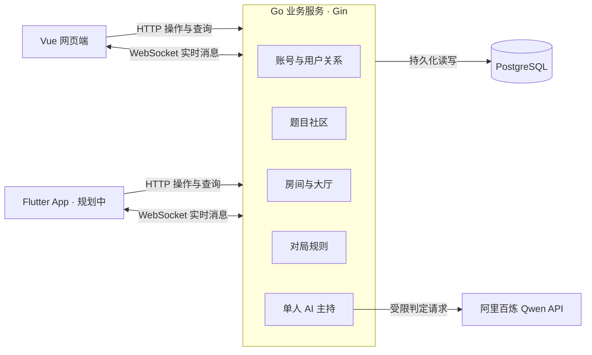
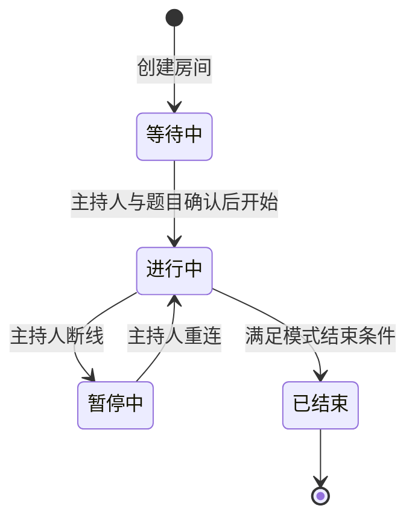

# 海龟汤项目规划

本文定义海龟汤平台的产品范围、技术架构与真人主持功能规则，不记录开发进度。单人 AI 主持的策略和评测另见《技术深化路线讨论稿》。

## 1. 项目概述

### 1.1 产品定位

平台将题目创作、题目社区和多人推理游戏连接起来。用户可以发布海龟汤，浏览与互动，也可以围绕一道题创建房间，与朋友或大厅里的其他玩家共同推理。真人主持人掌握汤底，对玩家的问题回答「是」「否」「无关」，并判定玩家提交的真相还原。

平台面向网页端与移动端。两端共享账号、题目、房间和对局数据，执行相同的服务端规则。

### 1.2 核心概念

| 概念 | 含义 |
| --- | --- |
| 题目 | 包含标题、汤面、汤底、类型、难度和恐怖程度的作品。 |
| 房间 | 一组参与者的集合，包含房主、主持人、玩家、旁观者、题目和模式设置。 |
| 对局 | 房间开始后的实际游戏过程，保存提问、回答、还原、判定和结束状态。 |
| 主持人 | 有权查看汤底并回答问题、判定还原的用户，不占玩家席位。 |
| 玩家 | 可以提问和提交还原的用户。 |
| 旁观者 | 可以查看允许公开的对局进展，但不能提问或提交还原。 |

### 1.3 范围

本文覆盖账号与用户关系、题目社区、房间与大厅、真人主持对局、共探模式和竞答模式。单人 AI 玩法、AI 创作、金币、排位等不纳入本文的功能规则；相关方案确定后再形成独立需求并接入平台。

## 2. 总体技术架构

### 2.1 系统组成

| 组件 | 职责 |
| --- | --- |
| Vue 网页端、规划中的 Flutter App | 展示数据、收集操作和接收实时消息；不自行决定用户能否查看汤底或参与对局。 |
| Go 业务服务 | 统一处理身份、权限、规则和状态变更。账号、题目、房间、对局按业务模块组织在同一个服务中。 |
| PostgreSQL | 保存账号、题目、互动关系、房间配置、成员身份和可恢复的对局记录；作为关键业务状态的权威来源。 |
| 阿里百炼 Qwen API | 在单人模式中按限定格式判定提问与真相还原；服务端验证结果并保存对局。 |

### 2.2 操作与实时消息

1. 客户端通过 HTTP 提交注册、发布题目、建房、加入、提问、主持回答等操作。
2. Go 服务校验登录身份、房间角色和当前状态；合法操作写入 PostgreSQL 后返回结果。
3. Go 服务通过 WebSocket 向有权限的房间成员推送变化。推送内容按接收者身份过滤，私人还原内容不得广播给其他玩家。
4. 客户端断线重连后从服务端重新获取房间和对局状态。实时通知只负责及时更新界面，不代替持久记录。

每次会改变对局的操作都应有可识别的操作 ID。网络重试不得产生重复问题、重复判定或重复结束事件；同一对局内的事件应有可比较的顺序。

### 2.3 权限与数据边界

- 汤底、未公开的还原内容、主持人的判定依据由服务端控制访问。隐藏按钮不等于权限控制。
- 房主、主持人、玩家、旁观者是房间或对局内的身份；同一用户在不同房间可以承担不同身份。
- 房间人数、开始条件、看汤底后的身份变化和结束条件由 Go 服务统一执行。并发请求下也必须满足这些规则。
- 登录会话用于识别用户；每次房间操作还需检查该用户在当前房间中的身份与状态。

### 2.4 技术选型

- **Gin**：处理 HTTP 路由、会话校验和请求输入；业务规则放在对应业务模块中，避免与 HTTP 处理代码混在一起。
- **PostgreSQL**：用事务、约束和索引保证关系数据与关键状态的一致性。
- **WebSocket**：为房间内问答、成员变化和对局状态提供实时推送；客户端重连仍以服务端状态为准。
- **Qwen API**：只处理单人主持的限定判定；额度、超时、结果校验与持久化由 Go 服务控制。

平台保持模块化单体。HTTP 和 WebSocket 面向客户端；内部模块直接调用，不为展示 gRPC 或服务发现而拆分服务。

## 3. 功能需求

### 3.1 账号与用户关系

**账号**

- 用户可以注册、登录和退出。用户名在平台内唯一；密码仅保存安全哈希，不保存明文。
- 登录后可以查看自己的资料及登录状态。修改个人资料时只能修改自己的信息。
- 未登录用户可以浏览公开题目；发布、互动、加入房间和参与对局需要登录。

**关注**

- 用户可以关注或取消关注其他用户，不能关注自己，也不能重复建立同一关注关系。
- 用户资料展示公开作品及关注信息；公开范围由页面设计与隐私规则统一确定。

### 3.2 题目社区

**发布与展示**

- 作者填写标题、汤面、汤底，并选择本格或变格、难度、恐怖程度。缺少标题、汤面或汤底时不能发布。
- 题目广场展示题目基本信息与汤面，不在列表中展示汤底。用户可以进入详情页查看作者、分类和互动内容。
- 题目作者可以管理自己发布的题目。已经被对局使用的题目需要保留当时的题目版本，避免编辑后改变进行中的谜底。

**汤底访问**

- 在普通题目详情页，用户可以主动查看汤底；操作前应清楚提示会产生剧透。
- 对局中的玩家不能直接通过游戏页面取得汤底。申请查看汤底并获准后，立即退出玩家席位并转为旁观者；本局不能重新成为玩家。
- 题目作者及已掌握本局汤底的用户不能在同一局以玩家身份参加。跨局是否限制同一题目的参与资格，暂按“每局单独判断”处理，并在实现时记录查看行为。

**互动**

- 登录用户可以对题目点赞、取消点赞、收藏、取消收藏，以及发布评论。同一用户对同一题目最多存在一条有效点赞关系和一条有效收藏关系。
- 评论公开展示时需要避免意外剧透；包含汤底的内容应有显著剧透标记或折叠展示。

### 3.3 房间与大厅

**创建与发现**

- 登录用户可以创建房间并成为房主。房主选择共探或竞答模式、人数上限、题目类型、难度、恐怖程度，以及是否公开到大厅。房主可从自己的题目列表选题，也可从题目广场选择他人的题目。
- 系统生成房间码。用户可用房间码进入房间；公开房间也可从大厅进入。房间码是进入方式，不替代服务端资格校验。
- 大厅只展示允许公开且可加入的房间，至少显示题目类型、难度、恐怖程度、模式、人数和房间状态；汤底不展示。

**成员与主持**

- 主持人可以是房主、题目作者，或申请主持的其他用户。房主负责确认主持人；同一局只保留一名生效主持人。
- 题目作者创建房间时可以自己主持；其他用户选用该题时，作者也可以申请主持。主持申请须先确认，确认前申请人不能查看本局汤底。
- 主持人查看汤底后不能转为本局玩家。房主不主持时可以作为玩家，但必须遵守相同的看汤底规则。
- 玩家人数不能超过房主设置的上限。重复加入只返回当前成员状态，不占用第二个席位。
- 房主可在开始前调整房间设置；开始后影响公平性的设置保持固定。

### 3.4 真人主持对局通用规则

**开始与主持**

- 对局开始时固定题目版本、模式、主持人及已入场成员。开始操作重复提交不得创建第二场对局。
- 主持人在游戏进行中不能主动退出主持身份。意外断线时对局暂停；主持人重连后恢复。暂停期间不接受新的有效提问或判定。

**提问与回答**

- 玩家提交问题，主持人只能选择「是」「否」「无关」之一作答。问题和回答按发生顺序进入本局记录。
- 非玩家不能提问；非主持人不能回答。重复提交的同一操作不会产生第二条问题或回答。
- 主持人回答后，房间成员可以看到该问题及回答；汤底和主持人的私有信息不随消息发送。

**还原真相**

- 玩家可以向主持人单独提交完整还原。主持人判定为「正确」「错误」「不完整」。
- 还原正文只对提交者和主持人可见；其他玩家只看到该玩家本次判定的结果，不看到还原内容。
- 同一次还原只能有一个最终判定。判定后的身份变化与结束条件由模式规则决定。

**查看汤底与旁观**

- 玩家可以申请查看汤底，由主持人批准或拒绝。批准后服务端先把申请者转为旁观者，再向其提供汤底；本局无法回到玩家席位。
- 旁观者可看到公开问答和结果，不能提问、提交还原或替主持人判定。

**恢复与结束**

- 断线不删除成员身份或已产生的问答。重连用户按当前身份获取状态；无权查看的私人内容仍不可见。
- 对局结束后不再接受提问、回答和还原；保留可回看的公开过程。汤底的最终公开方式由房间模式决定。

### 3.5 共探模式

- 玩家自由提问，不按固定顺序轮流。游戏开始后，符合人数与身份限制的用户仍可加入。
- 一名玩家还原正确后转为旁观者，其他玩家继续推理；其还原正文不向其他玩家公开。
- 玩家获准查看汤底后转为旁观者。未结束的玩家仍可继续游戏。
- 当房间内没有继续推理的玩家时，对局结束。主持人可在结束时公开汤底；结束后再进入房间的用户只能回看。

### 3.6 竞答模式

- 对局开始后锁定选手名单，新用户不能作为玩家中途加入；允许旁观，但旁观者不能变成选手。
- 玩家按固定顺序轮流提问，每轮每人一条问题，并受提问时限约束。超时视为放弃本轮，顺序转给下一位。
- 玩家可以提交完整还原。第一位被主持人判定还原正确的玩家获胜，对局立即结束。
- 若所有选手离开玩家席位且无人答对，对局结束并记录为无人获胜；竞答的胜负判定以服务端接受判定的顺序为准。

### 3.7 跨模块验收规则

- 并发加入不能超过房间人数上限；重复操作不能造成重复成员、问题、判定或结束记录。
- 任意用户均不能通过修改请求参数获取无权查看的汤底或私人还原。
- 用户刷新页面或断线重连后，房间成员、问题顺序、身份和对局状态与服务端记录一致。
- 两种模式都应覆盖主持人断线、玩家断线、申请查看汤底、重复提交和同时提交还原的情况。

## 4. 静态界面设计

### 4.1 网页端页面

首页是游戏功能的统一入口：多人房间、单人模式、题目社区、登录或个人主页、发布题目，以及管理员可见的后台入口。首页不设置顶栏或侧栏。内部页面只保留返回当前流程上一级的入口，不设置跨功能导航；列表进入详情、建房进入房间等属于当前流程。

| 页面 | 主要内容 |
| --- | --- |
| 首页 | 玩法入口、账号入口、发布入口与管理员入口。 |
| 登录与注册 | 账号输入、错误提示、登录状态。 |
| 题目广场 | 题目列表、分类信息、进入题目详情。 |
| 题目详情与发布 | 汤面、互动、汤底查看提示；作者发布与管理。 |
| 用户资料 | 公开作品、关注关系、个人资料。 |
| 房间大厅与建房 | 房间列表、房间码加入、题目与模式设置。 |
| 房间等待页 | 成员、主持确认、规则摘要、开始操作。 |
| 对局页 | 当前问题、回答、轮次、还原、看汤底申请和旁观状态。 |
| 结束页 | 结果、汤底与可公开的过程回看。 |
| 管理后台 | 后台首页进入账号、题目和运行日志管理；内页展示操作与链路详情。 |

当前网页静态稿按模块保存：[游戏与社区](design/ui/game/index.html)、[房间与单人模式](design/ui/play/gallery.html)、[管理后台](design/ui/admin/index.html)。桌面截图、重点页面的手机截图、弹窗状态及设计素材保存在同一目录。

### 4.2 App 页面

App 与网页端保持功能和规则一致。移动端分别设计题目浏览、题目详情、房间大厅、等待页、对局页和个人资料页；重点处理窄屏下的问题流、轮次提示、主持操作与还原输入。静态图在界面规则确定后补充到 `docs/design/`。
